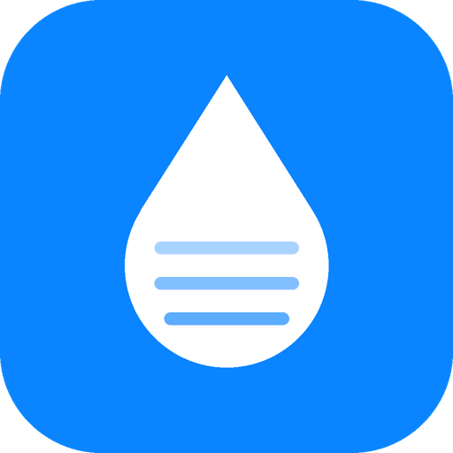

<p align="center"></p>

<h1 align="center">ResinPilot</h1>

<p align="center">A self-hosted manager for resin (MSLA) 3D printers.<br/>
Finds your printers on the network, shows them live, logs every print, and learns better exposure settings from your results.</p>

---

## What it does

- **Finds your printers by itself.** Open the app, press *Search network*, tick the printers you want. No IP addresses or config files to edit (you can still add a printer by IP when your network blocks discovery).
- **Live status for the whole fleet.** Printing / idle / error, progress and time left, vat and UV LED temperatures, release-film wear, and a banner for anything that needs attention.
- **Exposure profiles for today.** For each printer and the resin in its vat, ResinPilot suggests layer and bottom exposure for your usual layer heights, adjusted for room temperature (read from a printer's vat sensor).
- **Learns from your prints.** Report *success* or *fail* (with a reason: didn't stick, layers split, details closed up, …) and the recommendations shift for that printer, resin and part. Prints are grouped into parts from their file names, so a part you print often gets its own tuned settings.
- **History and insights.** A searchable print log (it can import past prints straight from the printers), success rates, settings timelines, recipe maps and failure breakdowns per printer.
- **Chitubox check (Windows).** Notices the model you open in Chitubox and the file you send to a printer, and warns when the file's exposures differ from the recommendation.
- **Runs on your computer.** Your printers, history and settings stay in a local folder. Nothing is sent anywhere.

## Supported printers

ResinPilot talks to printers through **drivers**. It ships with the **SDCP** driver for network-connected printers on ChiTu (CBD) mainboards, which is what ELEGOO's Wi-Fi resin printers use. SDCP has two generations. ResinPilot checks which one each printer reports, so the lists below show what to expect, and the app tells you if a printer can't be added.

**✅ Tested with ResinPilot:** SDCP 3, tuned starting exposures included.

| Brand  | Model                |
| ------ | -------------------- |
| ELEGOO | Saturn 4 Ultra 16K   |
| ELEGOO | Saturn 4 Ultra       |
| ELEGOO | Mars 5 Ultra         |

**🟢 Should work:** SDCP 3. Other SDCP 3 apps such as ChituManager and the Home Assistant integration report these working. They start from generic exposures until someone adds their profile.

| Brand  | Model      |
| ------ | ---------- |
| ELEGOO | Saturn 4   |
| ELEGOO | Mars 5     |
| Others | Resin printers on a networked ChiTu mainboard that report SDCP protocol V3 |

**🟡 Found, not supported yet:** older SDCP 1, where the printer connects to a message server (MQTT) run by the app. ResinPilot lists these as *Not yet* and won't add them until an MQTT transport is written. If a firmware update makes your printer report V3, it works.

| Brand  | Models |
| ------ | ------ |
| ELEGOO | Saturn 2 / 2 8K, Saturn 3, Saturn 3 Ultra |
| ELEGOO | Mars 3, Mars 3 Pro, Mars 4, Mars 4 DLP, Mars 4 Max, Mars 4 Ultra |
| ELEGOO | Jupiter, Jupiter SE (networked units) |

ELEGOO printers without networking (the original Mars, Mars 2 / 2 Pro, Mars C, Saturn, Saturn S, Saturn 8K, plus older models without the Wi-Fi option) can't be monitored, but you can still use ResinPilot's recommendations and log prints by hand.

SDCP *filament* printers (ELEGOO Centauri / Centauri Carbon) answer the same search; ResinPilot recognises them and leaves them out.

Printers missing from the model library start from exposures borrowed from the library model with the closest pixel size, then learn from your reports like any other printer. Adding a model is a small YAML entry; see [CONTRIBUTING.md](CONTRIBUTING.md). Tried a printer that isn't listed? Please [open an issue](https://github.com/PtolemyDL/ResinPilot/issues) with the model, firmware and what happened, and we'll update these lists.

### Other brands

These printers use other protocols and need their own driver. Drivers are plain Python classes and can live in separate packages ([how to write one](CONTRIBUTING.md#writing-a-printer-driver)).

| Printers | How they talk on the network | Driver |
| -------- | ---------------------------- | ------ |
| Anycubic Photon Mono M5s / M7 Pro / M7 Max and newer | *LAN Mode*: local MQTT after a signed handshake (see [anycubic-lan](https://pypi.org/project/anycubic-lan/)) | wanted |
| Older Anycubic Wi-Fi models (Photon Mono X, Mono X 6K, Mono SQ) | plain-text commands on TCP port 6000 | wanted |
| Prusa SL1 / SL1S | PrusaLink HTTP API | wanted |
| Creality HALOT series | WebSocket on port 18188 (HALOT Box), Creality Cloud | wanted |
| Phrozen, UniFormation, Formlabs, Longer, Voxelab and others | no documented local status API (cloud, file share, USB or vendor software only) | — |

## Install

### Windows: one file

Download `ResinPilot.exe` from the [latest release](https://github.com/PtolemyDL/ResinPilot/releases/latest) and double-click it. A console window shows the address and your browser opens the app. Close the window to stop it.

### Any OS: Python 3.10+

```bash
pipx install resinpilot        # or: pip install resinpilot
resinpilot
```

From source:

```bash
git clone https://github.com/PtolemyDL/ResinPilot.git
cd ResinPilot
python -m venv .venv && .venv/Scripts/activate     # macOS/Linux: source .venv/bin/activate
pip install -e ".[dev]"
resinpilot
```

### Options

```text
resinpilot [--port 8787] [--lan] [--tab] [--no-browser]

  --lan         let phones and other computers on your network open the app
                (otherwise only this computer can)
  --port        web port (default 8787, or the next free one)
  --tab         open in a normal browser tab instead of an app window
  --no-browser  don't open anything
```

ResinPilot has no login. Only use `--lan` on a network you trust.

## First run

1. Turn the printers on and connect them to the same network as your computer.
2. Start ResinPilot. It opens on **Printers** and searches straight away.
3. Rename printers if you like (e.g. "Left Mars") and press **Add selected printers**.
4. On **Today**, set the resin that is in each vat. The profiles follow it.
5. After each print, press **Report** on the printer's tile. The more you report, the better the suggestions get.

## Where your data lives

| OS      | Folder                                     |
| ------- | ------------------------------------------ |
| Windows | `%LOCALAPPDATA%\ResinPilot`                |
| macOS   | `~/Library/Application Support/ResinPilot` |
| Linux   | `~/.local/share/ResinPilot`                |

The folder holds `fleet.yaml` (your printers), `settings.json`, `history.db`, print previews and a `runs.jsonl` journal. Set `RESINPILOT_HOME` to use another folder, for example a synced one shared by several computers.

You can extend the built-in catalogs by putting `resins.yaml`, `baselines.yaml` or `printer_models.yaml` in that folder. Entries with the same `id` replace the built-in ones.

## Optional: shape scans

If [UVtools](https://github.com/sn4k3/UVtools) is installed, ResinPilot reads the layers of sliced files to describe each part's shape (thin walls, channels, large flat areas), which sharpens the per-part suggestions. Set `UVTOOLS_CMD` if UVtools is not found automatically.

## Disclaimer

Exposure suggestions are starting points, not guarantees. Resin and printer behaviour varies. Run a test print when you change resin or printer, and follow the resin maker's safety guidance. ResinPilot is not affiliated with ELEGOO, ChiTu or any printer maker.

## License

[MIT](LICENSE)
